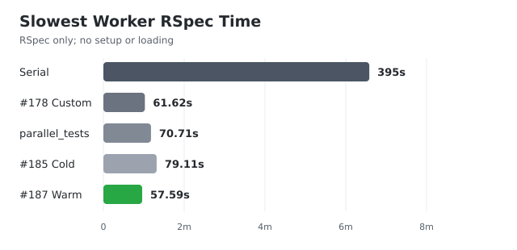

# Parallel Tests CI

[](https://rubygems.org/gems/parallel_tests-ci) [](https://github.com/dblock/parallel_tests-ci/actions/workflows/test.yml) [](https://github.com/dblock/parallel_tests-ci/actions/workflows/lint.yml) [](https://github.com/dblock/parallel_tests-ci/actions/workflows/package.yml) [](https://coveralls.io/github/dblock/parallel_tests-ci?branch=master)

Runtime-balanced RSpec shards for GitHub Actions, powered by [parallel_tests](https://github.com/grosser/parallel_tests). Timing history is collected and reused automatically.

## Installation

Requires Ruby 3.3+ and RSpec. Add to your Gemfile and run `bundle install`:

```ruby
gem 'parallel_tests-ci', '0.1.0', require: false
```

## Usage

Add `.github/workflows/test.yml`:

```yaml
name: Test
on: [push, pull_request]

permissions:
  contents: read
  actions: read

jobs:
  test:
    name: Test
    uses: dblock/parallel_tests-ci/.github/workflows/rspec.yml@v0.1.0
    with:
      shards: 8
```

Ruby comes from your version file; workers use Ubuntu by default. The first run groups by file size. Successful default-branch pushes supply timings for later runs; PRs read them without updating history. Jobs appear as `Test / 1 of 8`, capped at matching file count. Keep gem and workflow versions matched.

### Standalone Shard Matrix Action

If you manage your own CI jobs, see the [standalone test workflow](.github/workflows/test-standalone.yml) for how to plan shards and run the assigned specs. Replace `uses: ./` with `uses: dblock/parallel_tests-ci@<ref>` in your workflow.

## Configuration

### Runners and Execution

| Input             | Default         | Purpose                                             |
| ---               | ---             | ---                                                 |
| `runs-on`         | `ubuntu-latest` | Runner label or JSON label array for all jobs.      |
| `timeout-minutes` | `360`           | Minutes per job, including setup; positive integer. |
| `max-parallel`    | `256`           | Concurrent worker limit (1-256).                    |
| `fail-fast`       | `false`         | Cancel remaining workers on failure.                |
| `fetch-depth`     | `1`             | Checkout depth; `0` gets all history and tags.      |
| `ruby-version`    | Empty           | Override the caller's Ruby version.                 |
| `bundler-cache`   | `true`          | Cache gems; `false` still installs them.            |

### Suite and Setup

| Input           | Default                           | Purpose                                     |
| ---             | ---                               | ---                                         |
| `shards`        | `4`                               | Workers (1-256), capped at spec file count. |
| `worker-name`   | `{shard.number} of {shard.count}` | Worker label template.                      |
| `pattern`       | `spec/**/*_spec.rb`               | Repository-relative spec glob.              |
| `rspec-options` | `[]`                              | RSpec arguments as a JSON array.            |
| `environment`   | `{}`                              | Non-secret env vars as a JSON object.       |
| `before-bundle` | Empty                             | Shell setup before gem install in all jobs. |
| `setup`         | Empty                             | Shell setup before specs in each worker.    |

### Artifacts

| Input                     | Default             | Purpose                                             |
| ---                       | ---                 | ---                                                 |
| `artifacts`               | Empty               | Extra files to keep, even on failure.               |
| `artifact-prefix`         | `parallel-tests-ci` | Artifact name prefix; unique per call.              |
| `artifact-retention-days` | `30`                | Days to keep run artifacts; `0` uses repo default.  |
| `baseline-retention-days` | `90`                | Days to keep timing history; `0` uses repo default. |

See [Workflow Inputs](DESIGN.md#workflow-inputs) for templates, secret environments, and setup rules, and [Plans and Retries](DESIGN.md#plans-and-retries) for rerun behavior.

## Demo

[Posebook](https://github.com/dblock/posebook) runs 1,142 examples across eight workers. Times are for the slowest successful RSpec worker, excluding setup and spec loading.



- [Serial run](https://github.com/dblock/posebook/actions/runs/44218105420): 395s.
- [Custom sharding #178](https://github.com/dblock/posebook/pull/178): 61.62s.
- [`parallel_tests` alone #181](https://github.com/dblock/posebook/pull/181): 70.71s.
- [Cold run #185](https://github.com/dblock/posebook/pull/185): 79.11s.
- [Warm run #187](https://github.com/dblock/posebook/pull/187): 57.59s; timings for 85/95 files.

## Contributing

See [Contributing](CONTRIBUTING.md), [Coding Guidance](AGENTS.md), [Design](DESIGN.md), [Changelog](CHANGELOG.md), and [Releasing](RELEASING.md).

## License

Distributed under the [MIT License](LICENSE.txt).
